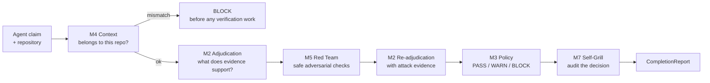
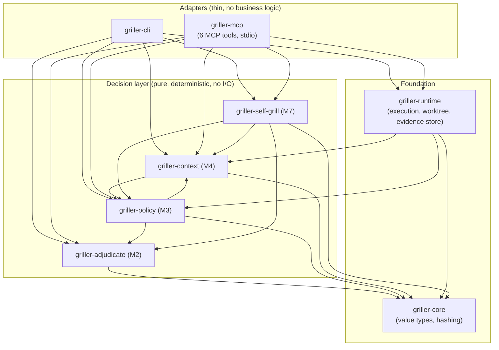

# The Griller

*A professional-grade asshole sitting between "I think this is correct" and
"we're going to trust it." 💅🔥*

The Griller is a deterministic verification engine for claims made by AI
coding agents. When an agent says *"I finished the task. All tests pass."*,
the Griller doesn't take its word for it — it checks the repository, replays
the verification, attacks the claim, and issues a verdict: **PASS**, **WARN**,
or **BLOCK**.

```text
Agent:  "I finished the task. All tests pass."
Griller: BLOCK — replayed `cargo test`; exit 1.
         Reason: CONTRADICTED_COMPLETION_BLOCK
         Required action: resolve the conflict before proceeding.
```

## Why does it exist?

AI agents are confident. Confidence is not correctness — especially when the
agent is in the wrong repository, ran a narrow subset of the tests, or simply
lied about running them at all. The Griller was built around one real incident:

> An agent was pointed at the **CodeBro** repository and asked to implement
> the **Atlas P10.5.1 Fact Store**. It happily did its best and reported
> success — in the wrong project.

Human review caught it late. The Griller catches it early: before any
high-confidence repository modification, it asks *"does this task actually
belong to this repository?"* — and blocks when the answer is no.

## What problem does it solve?

LLM-produced claims have no inherent epistemic weight. "Tests pass" is a
string, not a fact. The Griller separates three things that agent workflows
constantly conflate:

| Thing | Meaning | Example |
| --- | --- | --- |
| what the agent said | the claim | `"All tests pass."` |
| what the environment demonstrated | evidence | `cargo test` replayed: exit 1 |
| what policy allows us to conclude | the verdict | `BLOCK` |

**LLM proposes. Evidence disposes. Policy decides.** The agent proposes the
claim; deterministic collectors capture evidence; the policy table decides
what operational action follows.

## How does it work?

One MCP call — `griller.check_completion` — runs the entire pipeline:



Every stage is deterministic. Every verdict is backed by machine-readable
evidence references. The original decision is immutable — self-grill audits
it, never overrides it.

## Features

- **Context detection (M4)** — detects wrong-project work before it happens,
  via deterministic project/task identity. Absence alone never blocks; an
  explicit contradiction does.
- **Claim adjudication (M2)** — assigns an epistemic status
  (`verified`, `unsupported`, `uncertain`, `contradicted`, `false`,
  `unverifiable`) from evidence. Status is never a verdict.
- **Adversarial verification (M5)** — safe, worktree-isolated attacks:
  replay, presence/absence, stub sweep, safety.
- **Operational policy (M3)** — an explicit, auditable policy matrix maps
  status × kind × severity to PASS / WARN / BLOCK with stable reason codes.
- **Self-grill (M7)** — 16 deterministic structural checks audit the Griller's
  own decision pipeline.
- **MCP server** — six typed tools over stdio; OpenCode-ready.
- **Shell-free execution** — no shell, controlled environment, worktree
  isolation, best-effort secret redaction.

## MCP tools

| Tool | Purpose |
| --- | --- |
| `griller.health` | Server capabilities and security boundaries |
| `griller.verify_claim` | Adjudicate a single claim against repository evidence |
| `griller.check_context` | Does this task belong to this repository? |
| `griller.run_attacks` | Run applicable safe adversarial checks against a claim |
| `griller.check_completion` | The full pipeline: M4 → M2 → M5 → M2 → M3 → M7 |
| `griller.self_grill` | Self-audit of a decision produced elsewhere |

## Quick start

```sh
git clone <your-fork> the-griller
cd the-griller
cargo build --release -p griller-mcp
```

Then drive the pipeline three ways:

```sh
# 1. CLI: context check (read-only; exit 2 = BLOCK)
cargo run -p griller-cli -- context check \
  --task "Implement Atlas P10.5.1 Fact Store." --repo /path/to/your/repo

# 2. CLI: full M2+M3 decision (exit 0/1/2/3)
cargo run -p griller-cli -- claim decide \
  --claim "All tests pass" --repo . --auto-collect

# 3. MCP: the flagship completion check (see docs/opencode.md for setup)
cargo run -p griller-mcp
```

`--auto-collect` runs matching commands (e.g. `cargo test`) in an isolated
worktree — never in your working tree. Full walkthrough:
[docs/getting-started.md](docs/getting-started.md).

## OpenCode setup

Register the server in `opencode.jsonc` (config format verified against real
OpenCode during M8 field validation):

```jsonc
{
  "mcp": {
    "griller": {
      "type": "local",
      "command": ["/absolute/path/to/target/release/griller-mcp"],
      "enabled": true
    }
  }
}
```

Then ask OpenCode to call `griller.check_completion` with the agent's claim
and the repository path. Step-by-step guide with troubleshooting:
[docs/opencode.md](docs/opencode.md).

## Example: wrong project, blocked before verification

Real `griller.check_completion` output against a CodeBro repository while the
agent claims Atlas work:

```jsonc
{
  "schema_version": "m8.0",
  "verdict": "block",
  "reason_code": "MISMATCH_CONTEXT_BLOCK",
  "required_action": "confirm_project",
  "required_action_message": "Stop before modifying the repository and confirm the intended project/repository.",
  "context": {
    "status": "mismatch",
    "reason": "The task explicitly names another project with no supporting presence here.",
    "negative_evidence": [
      {
        "kind": "explicit_project_mismatch",
        "subject": "Atlas",
        "repository_identity": "CodeBro",
        "strength": "strong"
      }
    ]
  },
  "assessment": { "initial": null, "final": null },
  "attacks": { "planned": [], "results": [] },
  "self_grill": { "ran": false, "skipped_reason": "context mismatch blocked before adjudication" }
}
```

The block happens **before** any deep verification work: no adjudication, no
attacks, no wasted compute. The correct response to a wrong-repo task is
"stop and confirm the intended project" — the Griller judges, it does not fix.

## Example: honest claim, independently confirmed

The Griller never trusts the claim — it checks it:

- Claim: *"All tests pass."*
- Evidence: a real `cargo test` replay in an isolated worktree, captured as
  content-addressed evidence with exit code, output, and provenance.
- Result: `VERIFIED_COMPLETION_PASS` — the claim survived adjudication, the
  replay attack found no objection, and the self-grill audit held.

A PASS means "the environment demonstrated what the claim asserted." It does
**not** mean "the software is correct." See
[docs/concepts.md](docs/concepts.md) for exactly what each verdict means.

## Security model

Brutally honest, and reported truthfully by `griller.health` itself:

**Implemented:** shell-free execution, command allow-list, controlled
environment (no inherit-everything mode), worktree isolation, path
containment, best-effort secret redaction, bounded MCP inputs/outputs,
prompt-injection text treated as untrusted data, immutable hash-addressed
evidence.

**Not implemented:** kernel network isolation, OS sandbox, privilege
reduction, perfect secret detection, formal prompt-injection immunity.
The Griller is **not** a sandbox.

Full threat model: [docs/security.md](docs/security.md).

## Limitations

The Griller is honest about what it cannot guarantee. Highlights:

- No OS sandbox — verification runs with the calling user's privileges.
- Network egress is not kernel-enforced (`network_policy: disabled` sets
  `GIT_TERMINAL_PROMPT=0`; nothing more).
- Replay currently derives Rust/`cargo` commands from claims; other
  language ecosystems have reduced coverage.
- `ADVERSARIALLY_VERIFIED` requires attack coverage that the deterministic
  pipeline cannot yet produce.

Complete list: [docs/limitations.md](docs/limitations.md).

## Architecture

Eight crates, one direction of dependency. Pure decision crates depend only
on `griller-core`; all I/O lives in `griller-runtime`; the CLI and MCP server
are thin adapters that wire the pipeline together — **MCP is an adapter, not
the core**:



Dependency direction is enforced by crate boundaries: the decision crates
contain no filesystem access, no subprocesses, no network, and no LLM client.
[docs/architecture.md](docs/architecture.md)

## Development & testing

```sh
cargo fmt --all -- --check
cargo check --workspace
cargo test --workspace        # 424 tests at final M8 field validation
cargo clippy --workspace --all-targets --all-features -- -D warnings
cargo audit                   # 0 vulnerabilities across 230 dependencies
```

Everything is testable without an LLM: unit tests, golden fixtures,
adversarial fixtures, protocol tests over real stdio, and an OpenCode field
validation that exercised the real binary outside unit tests.
[docs/testing.md](docs/testing.md) · [docs/development.md](docs/development.md)

## Project status

**M0–M8 complete.** The full M0→M8 implementation is done:

- Real MCP stdio integration verified (protocol-level tests launch the real
  binary).
- Real OpenCode discovery and workflow verified against the actual OpenCode
  configuration format.
- 424 workspace tests passing at the final M8 field-validation run.
- `cargo clippy --all-targets --all-features -- -D warnings` clean.
- `cargo audit`: 0 vulnerabilities across 230 dependencies at the final M8
  field-validation run.

These numbers describe a point in time — they are not a promise about the
future. The field validation caught a real worktree-pollution bug that was
fixed before the final run; that is the point of validating outside unit
tests. See [docs/verification-pipeline.md](docs/verification-pipeline.md)
for what was validated.

## Documentation

| Topic | Documentation |
| --- | --- |
| Getting started | [docs/getting-started.md](docs/getting-started.md) |
| Core concepts | [docs/concepts.md](docs/concepts.md) |
| Architecture | [docs/architecture.md](docs/architecture.md) |
| Verification pipeline | [docs/verification-pipeline.md](docs/verification-pipeline.md) |
| Evidence model | [docs/evidence.md](docs/evidence.md) |
| Context detection | [docs/context-detection.md](docs/context-detection.md) |
| Red team | [docs/red-team.md](docs/red-team.md) |
| Self-grill | [docs/self-grill.md](docs/self-grill.md) |
| MCP server | [docs/mcp.md](docs/mcp.md) |
| OpenCode integration | [docs/opencode.md](docs/opencode.md) |
| Security model | [docs/security.md](docs/security.md) |
| Limitations | [docs/limitations.md](docs/limitations.md) |
| Testing | [docs/testing.md](docs/testing.md) |
| Development | [docs/development.md](docs/development.md) |
| Milestone history | [docs/history/](docs/history/) |

## Product philosophy

The Griller does not try to make AI correct. It makes AI claims harder to
trust blindly.

It separates **what the agent said** from **what the environment
demonstrated** from **what the policy allows us to conclude**. The separation
is the product. Trust the receipts, not the narration — and if you cannot
produce the receipts, that is not a PASS.

## License

MIT OR Apache-2.0.