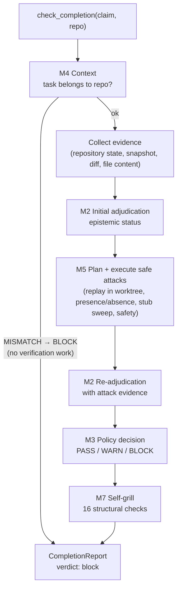
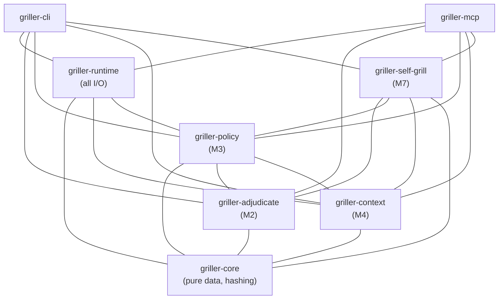

# Architecture

## The two-layer principle

The Griller is built on one structural rule that everything else follows:

> **LLM proposes. Evidence disposes. Policy decides.**

The codebase is split into two layers with a hard dependency direction:

- **Decision layer** — pure, deterministic crates with no I/O: they compute
  epistemic status, context, verdicts, and audits from structured inputs.
  No filesystem, no subprocesses, no network, no LLM client.
- **Foundation + adapters** — `griller-runtime` performs all I/O (execution,
  git, worktree, evidence store, project identity collection). The CLI and the
  MCP server are thin adapters that wire the pipeline together. **MCP is an
  adapter, not the core.**

## The completion pipeline

`griller.check_completion` is the flagship entry point. One call, one
auditable report:



Each stage's authority is deliberately narrow. What it may decide and what it
may not is documented stage by stage in
[verification-pipeline.md](verification-pipeline.md).

## Crate layout

```
the-griller/
├── Cargo.toml                 # workspace root
├── crates/
│   ├── griller-core/          # value types, canonical JSON, BLAKE3 hashing (pure)
│   ├── griller-runtime/       # execution, git, worktree, collectors, evidence store, identity (I/O)
│   ├── griller-adjudicate/    # M2: claims, matching, epistemic status (pure)
│   ├── griller-policy/        # M3: severity, policy matrix, verdicts (pure)
│   ├── griller-context/       # M4: project/task identity, context status (pure)
│   ├── griller-self-grill/    # M7: 16-check decision audit (pure)
│   ├── griller-cli/           # the `griller` binary (adapter)
│   └── griller-mcp/           # the MCP stdio server, six tools (adapter)
├── tests/
│   └── fixtures/              # static adversarial + golden fixtures
└── docs/                      # this documentation
```

## Dependency direction

Verified from the workspace `Cargo.toml` files:



In prose:

- `griller-core` is the only leaf. It contains domain/value types, canonical
  JSON serialization, and BLAKE3 content hashing — and nothing else.
- `griller-adjudicate`, `griller-policy`, `griller-context` and
  `griller-self-grill` are the decision layer: pure, deterministic, no I/O.
  They depend only on each other and on `griller-core`.
- `griller-runtime` is the only place that touches the outside world: process
  execution, git invocation, worktree management, evidence persistence,
  project identity collection.
- `griller-cli` and `griller-mcp` are adapters: they translate user input
  into Griller APIs and render structured JSON. **No business logic lives in
  the adapters.** The one orchestration exception is the
  `check_completion` pipeline in `griller-mcp/src/completion.rs`, which wires
  existing stages together and does not re-implement any of them.

## Module map (runtime — the I/O layer)

| Module | Responsibility |
| --- | --- |
| `execution` | shell-free process execution, environment policies, timeouts |
| `git` | git invocation helpers on top of the execution backend |
| `worktree` | repository discovery + disposable isolated worktree |
| `manifest` | deterministic manifest detection |
| `vocabulary` | deterministic vocabulary signals |
| `collectors` | repository state, git diff, manifest, file content, snapshot, command output |
| `identity` | `ProjectIdentityCollector` (deterministic, read-only) |
| `store` | JSON evidence store (replaceable backend) |
| `attack` | M5 attack executor + command allow-list validation |

## Module map (decision layer)

| Crate | Key modules |
| --- | --- |
| `griller-adjudicate` (M2) | `claim`, `normalizer`, `llm` (strict output boundary), `matcher`, `support` (SupportMatrix), `contradiction`, `status`, `assess`, `attack_coverage` |
| `griller-policy` (M3) | `severity`, `table` (the auditable policy matrix), `verdict`, `decision`, `policy`, `finding`, `context` (M4→M3 bridge), `diva` (decorative renderer) |
| `griller-context` (M4) | `name`, `project` (ProjectIdentity), `task` (TaskIdentity), `normalizer`, `llm`, `evidence` (ContextEvidence), `matcher`, `status`, `assess` |
| `griller-self-grill` (M7) | `domain` (SelfGrillInput/Result, outcome semantics), `checks` (16 checks), `runner` (single-pass, non-recursive) |

## Guiding constraints

- **No MCP and no LLM provider in the decision layer.** The LLM path is a
  trait plus a strict parsing boundary; a provider is never required. The
  deterministic path works without any LLM.
- **Verdicts are operational decisions, never truth claims.** M3 never
  re-derives epistemic status; M4 never invents a verdict.
- **The policy matrix is an explicit, auditable table**, not a rule engine.
  Unmatched combinations default to `WARN`, never `PASS`.
- **M4 decides context, never action.** No PASS/WARN/BLOCK exists in
  `griller-context`; the M4→M3 bridge in `griller-policy` owns verdicts.
  Absence is not mismatch.
- **Evidence identity describes what was observed; provenance describes
  where/how/when.** Content hashes never depend on timestamps, absolute
  paths, or environment fingerprints.
- **Agent narration can never be upgraded into environment evidence.**
  Provenance makes the distinction structural, not conventional.
- **Self-grill never mutates the original decision.** It audits; the caller
  acts.
- Prefer boring, explicit, testable Rust. Every abstraction must justify
  itself through testability, isolation, replaceability, or domain
  correctness.

## Historical context

This architecture evolved through milestones M0–M8. The milestone
implementation reports — including the original M0/M1 evidence foundation,
worktree isolation, and hardening decisions — are preserved under
[docs/history/](history/). The docs here describe the current state, not the
journey.