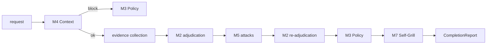
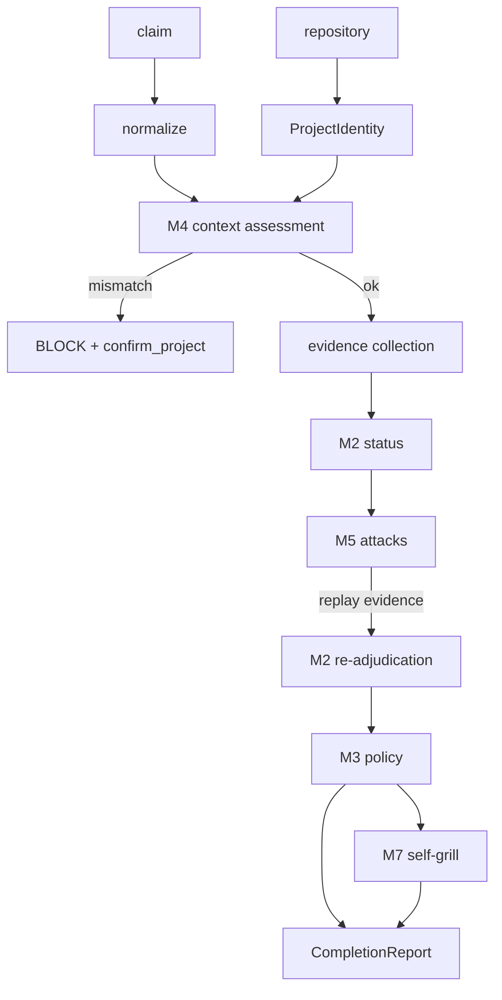

# Verification pipeline

`griller.check_completion(repo, claim)` runs the entire lifecycle in one call
and returns a single auditable report. This document walks through every
stage: what goes in, what happens, what comes out — and, just as important,
what each stage is **allowed** to decide and what it **cannot** decide.



## Stage 0 — Request validation

**Input:** `repo` path, `claim` text, optional `claim_kind`, optional
`timeout` (ms).

**Process:** boundary validation — non-empty bounded text (≤ 10 000 chars),
existing repository path (≤ 2 000 chars), timeout capped at 600 s.

**Output:** a validated `CompletionRequest`, or a structured error
(`invalid_request`, `repository_not_found`) that is never a verdict.

**May decide:** that the request is well-formed.

**Cannot decide:** anything about the claim.

## Stage 1 — M4 context adjudication

**Question:** *Does this task appear to belong to this repository?*

**Input:** the claim (treated as the task) + a deterministic `ProjectIdentity`
collected from the repository itself (root dir name, manifest/package names,
git remotes, paths, symbols, README title).

**Process:** normalize the task, extract candidate entities, match them
against the project identity, collect positive and negative context evidence,
and assign a `ContextStatus`.

**Output:** `ContextAssessment` with `positive_evidence`,
`negative_evidence`, and a status (`MATCHED`, `LIKELY_MATCH`, `AMBIGUOUS`,
`WEAK_RELEVANCE`, `MISMATCH`, `INSUFFICIENT_CONTEXT`), mapped through the M3
policy bridge to an operational verdict.

**May decide:** whether the task demonstrably names another project
(`MISMATCH`).

**Cannot decide:** anything about the claim's truth. Absence of evidence is
never mismatch. A strong mismatch short-circuits the pipeline **before** any
adjudication or attack work — that is the wrong-project protection, and it is
cheap by design.

## Stage 2 — Evidence collection

**Input:** the repository + the normalized claim.

**Process:** deterministic collectors capture:

- project identity (always),
- repository state, snapshot, git diff (git-dependent collectors degrade
  gracefully on non-git repositories),
- file content — when the claim names a path-like target (`src/greet.rs`),
  that file is read so existence claims resolve with direct evidence. A
  missing file is not an error.

Everything runs read-only. Nothing is patched, committed, or executed yet.

**Output:** a list of content-addressed `Evidence` records.

**May decide:** what was observed.

**Cannot decide:** what the observations mean for the claim — that is M2's
job.

## Stage 3 — M2 initial adjudication

**Question:** *What does the evidence actually support?*

**Input:** the normalized claim + collected evidence.

**Process:** classify the claim, match each evidence record
(`supports` / `contradicts` / `irrelevant` / `insufficient` /
`unverifiable`), check for structural contradictions, and assign one
epistemic status.

**Output:** `ClaimAssessment` with a status
(`VERIFIED` … `FALSE`), supporting/contradicting evidence references, and a
SupportMatrix.

**May decide:** the epistemic status.

**Cannot decide:** a verdict. M2 produces no PASS/WARN/BLOCK — tested as
unreachable.

## Stage 4 — M5 adversarial attacks

**Question:** *Can safe adversarial checks find a legitimate objection?*

**Input:** the claim + the initial assessment.

**Process:** the Griller derives a deterministic attack plan from the claim
itself — never from the caller:

- `test`/`pass`/`fail` → `cargo test`
- `clippy`/`lint` → `cargo clippy --all-targets --all-features`
- `fmt`/`format` → `cargo fmt --all -- --check`
- `check` → `cargo check --workspace`
- `build`/`compil` → `cargo build`

plus the other applicable implemented kinds (presence/absence, stub sweep,
safety). Replay commands run in a disposable **worktree** with an
allow-listed environment and network disabled — the user's working tree is
never mutated. Non-git paths fall back to in-place execution of read-only
commands.

**Output:** per-attack results (`no_objection`, `refuted`, `confirmed`,
`inconclusive`, `not_applicable`, `execution_failed`) + an `AttackCoverage`
summary. Replay evidence is fed back into the evidence set.

**May decide:** that an attack found no objection — *within that attack's
scope*.

**Cannot decide:** that the claim is true. `NO_OBJECTION` is positive
adversarial evidence, not proof. `EXECUTION_FAILED` is not refutation.

## Stage 5 — M2 re-adjudication

**Input:** the claim + base evidence **plus** the replayed attack evidence.

**Process:** the same deterministic adjudicator runs again, so *"All tests
pass."* is matched against the actually replayed run, not the agent's word.

**Output:** the final `ClaimAssessment`.

**May decide:** the final epistemic status, now adversarially informed.

**Cannot decide:** the verdict.

## Stage 6 — M3 policy decision

**Question:** *What operational action should follow?*

**Input:** final assessment + derived severity.

**Process:** the auditable policy matrix maps status × kind × severity:

```text
VERIFIED / ADVERSARIALLY_VERIFIED -> PASS
UNSUPPORTED / UNVERIFIABLE        -> BLOCK (make verification available)
CONTRADICTED                      -> BLOCK (resolve the conflict)
UNCERTAIN                         -> WARN
```

**Output:** verdict (`PASS`/`WARN`/`BLOCK`), stable reason code, required
action, and its message.

**May decide:** what the system should do.

**Cannot decide:** whether the claim is true. A BLOCK never means "false" —
it means "cannot be accepted as-is." A failed verification is always a
verdict, never an error.

## Stage 7 — M7 self-grill audit

**Question:** *Did the Griller's own decision structure survive audit?*

**Input:** the real pipeline data — final assessment, decision, context
assessment, attack coverage, evidence, severity.

**Process:** 16 deterministic structural checks: evidence references resolve,
evidence is independent, agent claims never upgraded, policy recomputes to
the same verdict, reason/action consistency, hash integrity, redaction
invariants, attack coverage conditions, and more. Exactly one pass; no
recursion; no LLM.

**Output:** `SelfGrillResult` (`HOLDS` / `WEAKENED` / `INCONCLUSIVE` /
`REFUTED` / `NOT_APPLICABLE`) with per-check findings, alongside the
**immutable** original decision.

**May decide:** whether the decision pipeline was structurally consistent.

**Cannot decide:** anything about the software, and never overrides the
original verdict. A `REFUTED` audit is reported (`self_grill.refuted: true`)
with the original verdict standing.

When the pipeline was blocked before adjudication (context mismatch), the
audit is skipped with an explicit `skipped_reason` rather than run on empty
input — a spurious REFUTED would be noise, not honesty.

## The report

Decision fields lead the document so a caller reads the verdict without
parsing the whole payload:

```jsonc
{
  "schema_version": "m8.0",
  "verdict": "block",                    // decision first
  "reason_code": "MISMATCH_CONTEXT_BLOCK",
  "required_action": "confirm_project",
  "required_action_message": "…",
  "request": { "repo": "…", "claim": "…", "claim_kind": "completion" },
  "context":    { "status": "…", "verdict": "…", "positive_evidence": […], "negative_evidence": […] },
  "assessment": { "initial": {…}, "final": {…} },
  "attacks":    { "planned": […], "results": […], "coverage": {…}, "rejected": […] },
  "self_grill": { "ran": true, "refuted": false, "original": {…}, "result": {…} },
  "timing":     { "context_ms": …, "identity_ms": …, "evidence_ms": …,
                  "adjudication_ms": …, "attacks_ms": …, "self_grill_ms": …,
                  "total_ms": …, "evidence_count": … }
}
```

Output is bounded: evidence lists are truncated to 10 snippets, claims are
capped at 10 000 chars, and a report stays well under 256 KiB in practice
(tested).

## Evidence/decision flow



## What was validated in the field

The pipeline was exercised against real fixtures outside unit tests: wrong
project (BLOCK before attacks), generic task (WARN, never a false BLOCK),
lying completion (replay refutes), prompt injection (inert), unsafe payload
(never executed), valid completion (PASS), bounded reports, and a real
OpenCode workflow. See [testing.md](testing.md) and the M8 historical report
in [history/m8-integration.md](history/m8-integration.md).